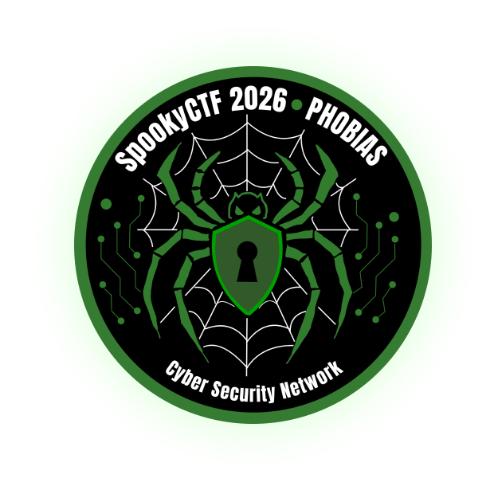

# SpookyCTF 2026

  

## Event Overview

- **Event:** SpookyCTF 2026
- **Host:** NJIT Cyber Security Network (CSN)
- **Format:** Jeopardy-style CTF
- **Environment:** Authorized competition infrastructure
- **Participation:** Solo
- **Dates:** 6–7 November 2026
- **Official event page:** [spooky.ctfd.io](https://spooky.ctfd.io/)

## About this entry

This page tracks my participation and learning notes for SpookyCTF 2026. Challenge write-ups will be selected and published after checking the event's rules and any organizer guidance. No flags are included.

## Categories

- [Forensics](../forensics/README.md)
- [Crypto](../crypto/README.md)
- [Web](../web/README.md)
- [Binary Reverse Engineering](../binrev/README.md)
- [OSINT](../osint/README.md)
- [Miscellaneous](../misc/README.md)

## Publication status

Participation notes are being collected. Selected technical write-ups and sanitized evidence will be added when event publication rules permit.