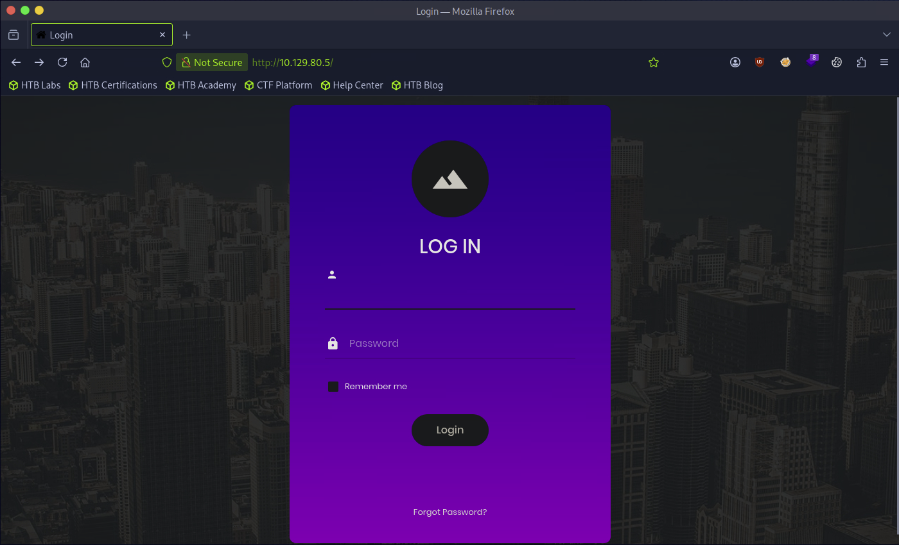
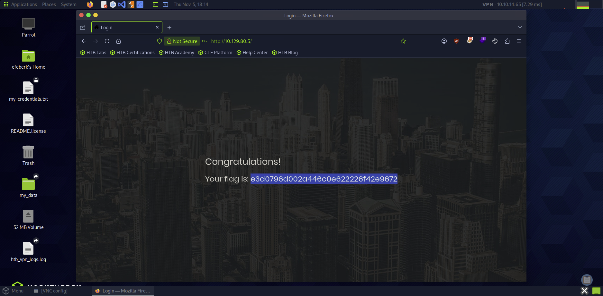

# Appointment

    

Lab link: [Appointment](https://app.hackthebox.com/starting-point)

## Completion proof

## Login page

## Flag retrieval

## What I did

1. Opened the target's web page and found a login form.
2. The task identified SQL injection and explained that `#` comments out the rest of a MySQL line. I entered `admin'#` as the username and any value as the password. The apostrophe closes the username string and `#` comments out the password condition in the vulnerable query.
3. The login succeeded and the page displayed the flag. I submitted it to complete the lab.

This write-up records the successful lab path and does not transcribe the flag value.
