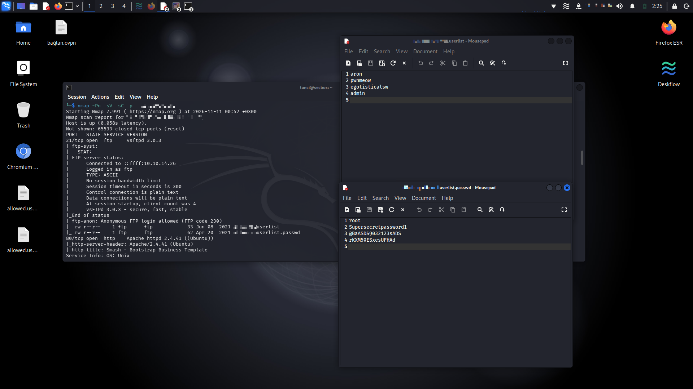
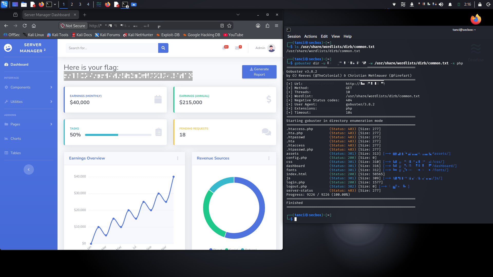

# Crocodile

    

Lab link: [Crocodile](https://app.hackthebox.com/starting-point)

## Completion proof


## Overview

Crocodile is a Very Easy Hack The Box Starting Point machine focused on connecting FTP and web enumeration findings. The investigation involved anonymous FTP access, local file retrieval, and discovery of a web login page.

## Objective

The objective was to identify the exposed services, inspect the information available through anonymous FTP, locate the relevant web login page, and use the discovered information to complete the lab.

## Scope and evidence

This write-up documents activity performed against the authorized Hack The Box Starting Point target. Target addresses, credentials, recovered passwords, and the flag are intentionally omitted.

## Investigation process

### 1. Service enumeration

I began with a full TCP service scan to understand the target's exposed attack surface:

```bash
nmap -Pn -sV -sC -p- <target-ip>
```

The scan identified FTP on TCP port 21 and HTTP on TCP port 80. FTP reported `vsftpd 3.0.3`, and the web service identified itself as Apache HTTP Server. The scan also indicated that anonymous FTP login was allowed, so FTP was the first service to investigate.



### 2. Anonymous FTP access

I connected to the FTP service and tested the anonymous account:

```bash
ftp <target-ip>
```

After entering `anonymous` as the username, the server returned a successful login response. I listed the remote directory:

```text
ftp> ls
```

The listing contained two files:

```text
allowed.userlist
allowed.userlist.passwd
```

The filenames suggested that the anonymous share exposed account information. I downloaded the files for local inspection:

```text
ftp> get allowed.userlist
ftp> get allowed.userlist.passwd
```

The recovered authentication material is not reproduced in this write-up.

### 3. Web directory enumeration

I enumerated common web paths and PHP files to identify the application entry points:

```bash
gobuster dir -u http://<target-ip> \
  -w /usr/share/wordlists/dirb/common.txt \
  -x php
```

The scan returned several paths, including `login.php`, `logout.php`, `config.php`, `dashboard/`, `assets/`, `css/`, `fonts/`, and `js/`. The important discovery was `login.php`, which provided the web authentication interface.

Gobuster's results also showed why response codes need context: redirects marked directory paths, denied responses indicated restricted resources, and a successful response with no body did not prove that a useful file was exposed.

### 4. Logging in and completing the lab

After finding `login.php`, I compared the usernames in `allowed.userlist` with the corresponding passwords in `allowed.userlist.passwd`. The lists included an `admin` account. I used that account and its matching password to log in through the web page. The authenticated page displayed the flag, which I submitted to complete Crocodile.



## Technical analysis

The central concept was cross-service enumeration. Anonymous FTP exposed files that became useful when investigating the HTTP service. The complete path was not visible from a single scan; it emerged by correlating the FTP listing, the downloaded files, and the web application's login endpoint.

This challenge also reinforced the importance of treating enumeration output as evidence. Service versions, anonymous access, filenames, HTTP status codes, and redirects each narrowed the next investigation step.

## Lessons learned

- Test anonymous access whenever an FTP service permits it.
- Inspect exposed files locally and relate their names to other services.
- Use web directory enumeration to identify application entry points.
- Interpret HTTP status codes together with response size and redirect behavior.
- Keep target scope and sensitive values out of public notes.

## Result

The Crocodile challenge objective was completed successfully. The flag and recovered authentication data are not published here.
